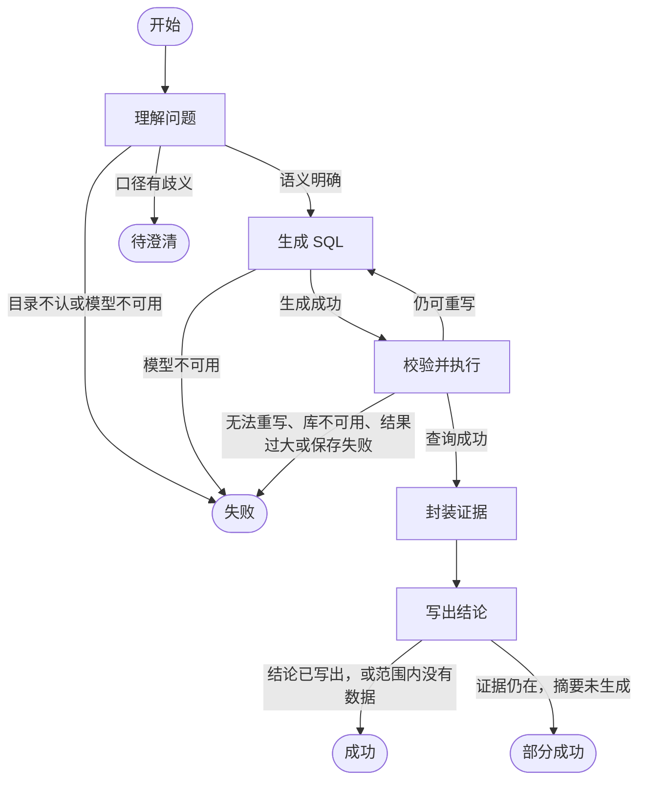

# 数据分析 Agent

一次处理一个自包含查数任务：把问题收成指标目录中的业务语义，生成并校验只读 SQL，执行后封装成证据，再写出只引用该证据的结论。

节点顺序固定。模型只负责理解问题、起草 SQL 和写摘要。指标口径在 `config/metrics.yaml`，SQL 约束在 `config/sql_policy.yaml`。

## 1. 功能

- 解析出指标、维度、过滤、时间范围、排序和条数，并对照指标目录校验。
- 生成一条只读查询。能命中预聚合视图就查视图，否则回退原始表。
- 执行前检查语法、数据源与列、函数和扫描量，并限制返回行数。在线查询使用只读账号。
- 成功后保存表格和 SQL，形成一条可供下游引用的证据。
- 摘要只陈述证据中能核对的数字、排名和范围。摘要失败时仍返回证据，结果标为部分成功。

## 2. 输入输出

公开输入是 `AnalysisRequest`，公开输出是 `AnalysisResult`（`AgentResult[AnalysisOutput]`）。

### 输入

| 字段 | 含义 |
| --- | --- |
| `task_id` | 任务标识，用来关联追踪、产物和结果。命令行省略时自动生成。 |
| `question` | 自包含问题，最长 4000 字。 |
| `semantic_spec` | 可选。测试或程序化调用可直接传入已确认语义，仍须通过指标目录校验。 |
| `locale` | 结论文案的语言，默认 `zh-CN`。不影响指标口径和 SQL。 |

### 输出外壳

| 字段 | 含义 |
| --- | --- |
| `status` | `success` 证据完整；`partial` 证据可用、摘要降级；`needs_input` 需要补充会改变答案的信息；`failed` 没有可用结果。 |
| `value` | 业务结果。成功和待补充时必有；失败时为空。 |
| `error` | `code`、`stage`、`message`、`retryable`、`context`。不含密钥、SQL 全文和异常栈。成功时为空。 |
| `warnings` | 不改变终态的提示，例如结果被行数上限截断。 |

### `value`

| 字段 | 含义 |
| --- | --- |
| `task_id` | 回传输入中的任务标识。 |
| `intent` | 最终采用的业务语义。尚未形成语义时为空。 |
| `evidences` | 可引用的数据事实。成功时一条。 |
| `headline` | 直接回答问题的一句话。 |
| `claims` | 带 `evidence_id` 的事实。引用不存在的证据时校验失败。 |
| `limitations` | 覆盖范围、口径、截断，以及不能据此做因果解释。 |
| `clarification_questions` | 待补充时向调用方提出的问题。 |

## 3. 使用示例和使用注意事项

在仓库根目录执行。`.env` 已配置模型密钥和只读账号，库与视图已建好。

```bash
agentic-bi-analysis "2017 年哪个客户州的 GMV 最高？"
```

```python
from agentic_bi.agents.analysis import AnalysisRequest, run_analysis

result = run_analysis(
    AnalysisRequest(
        task_id="demo-2017-state",
        question="2017 年哪个客户州的 GMV 最高？",
    )
)
```

- 一次只问一件事。「先找最高的州，再查该州准时率」要拆成两次。
- 时间左闭右开。完整 2017 年是 2017-01-01 到 2018-01-01。
- 成交额含商品价格和运费，不含已取消、不可用订单，单位是雷亚尔。
- 问题里有会改变答案的歧义时，先返回澄清问题，不继续查数。
- 查数只用只读账号。语义解析、SQL 生成和摘要都会显式关闭思考。
- 查到数但摘要失败时，证据仍可核对。没有数据时直接说明未查到，不再生成摘要。
- 单条查询默认超时 10 秒，最多保留 5000 行、10 MiB，预览 20 行。用户要的条数最多 500。
- SQL 默认最多重写 2 次。语法、列不一致、函数或扫描量问题可以重写；写入、多语句、库名或未授权的表直接失败。
- 表格和 SQL 写在 `runtime/artifacts/`，不要提交。

## 4. 内部处理流程



1. **理解问题**。抽出指标、维度、过滤、时间和排序，再对照指标目录。口径有歧义则待澄清。目录不认或模型不可用则失败。
2. **生成 SQL**。只把当前指标和维度允许的数据源交给模型。重写时附上上一轮的短失败说明，要求给出完整语句。模型不可用则失败。
3. **校验并执行**。检查语法和权限，看执行计划，用只读账号查询，核对结果列，再保存表格和 SQL。仍可重写时回到生成；无法重写、库不可用、结果过大或保存失败则失败。
4. **封装证据**。把业务范围、预览、来源和产物引用合成一条事实。证据里不放 SQL 全文。
5. **写出结论**。每条事实陈述都指向这条证据。结论写完，或范围内没有数据，为成功。证据已保留但摘要未生成，为部分成功。

## 5. 内部字段结构含义

图状态只保留小样本和文件引用，不保留模型、连接和完整结果集。

| 字段 | 写入步骤 | 含义 |
| --- | --- | --- |
| `request` | 输入 | 原始查数任务。 |
| `semantic_spec` | 理解问题 | 通过指标目录、且没有未解歧义的业务语义。 |
| `sql_draft` | 生成 SQL | 最近一次候选 SQL，尚未执行。 |
| `query_snapshot` | 校验并执行 | 列、预览、行数、指纹和产物引用。 |
| `evidence` | 封装证据 | 可供下游引用的一条数据事实。 |
| `repair_attempts` | 理解成功时为 0，重写时加 1 | 已经用掉的 SQL 重写次数。 |
| `repair_feedback` | 重写时写入，生成成功后清空 | 下一轮可见的短失败说明。 |
| `result` | 澄清、失败或摘要 | 提前结束或最终返回的结果。 |

### `semantic_spec`

| 字段 | 含义 |
| --- | --- |
| `metric_ids` | 要计算的标准指标，例如 `total_gmv`。须来自指标目录，且共享同一粒度。 |
| `dimensions` | 分组维度，例如 `customer_state`。为空表示整段汇总成一个数。 |
| `filters` | 不含时间的业务过滤。每项为 `field`、`operator`、`value`。运算符有 `eq`、`ne`、`gt`、`gte`、`lt`、`lte`、`in`、`not_in`、`between`、`contains`、`is_null`、`is_not_null`。 |
| `time_range` | `start` 含当天，`end` 不含当天，`timezone` 默认 `UTC`。 |
| `operation` | `scalar` 单值，`table` 表格，`ranking` 榜单，`trend` 趋势，`distribution` 分布，`auto` 按问题判断。 |
| `sort_by` | 排序用的当前指标或维度。不排序时为空。 |
| `sort_direction` | `asc` 或 `desc`。只在有排序字段时使用，省略时按降序。 |
| `limit` | 业务条数，1 到 500。「哪个最高」通常是 `ranking` 且为 1。 |
| `ambiguities` | 会改变答案、又无法从问题确定的点。没有则为空。 |

「2017 年哪个客户州的 GMV 最高」对应：`metric_ids=total_gmv`，`dimensions=customer_state`，时间为 2017-01-01 至 2018-01-01，`operation=ranking`，按 `total_gmv` 降序，`limit=1`。

### `sql_draft`

| 字段 | 含义 |
| --- | --- |
| `sql` | 一条尚未执行的查询。输出列使用语义中的标准标识做别名。 |
| `design_notes` | 数据源、粒度和聚合方式的短说明。 |

### 查询快照与证据

快照留在图状态中。封装证据时与语义合并，下游只看证据。

| 字段 | 含义 |
| --- | --- |
| `evidence_id` | 证据标识。`claims` 用它回指。 |
| `metric_ids` / `dimensions` | 从语义原样带入。 |
| `grain` | 一行代表什么。当前等于分组维度。 |
| `scope` | `filters`、`time_range`、`operation`、`sort_by`、`sort_direction`、`limit`。 |
| `units` | 指标单位。`total_gmv` 为 `BRL`。 |
| `columns` | 结果列名，与 SQL 别名一致。 |
| `preview` | 小样本，默认最多 20 行。 |
| `row_count` | 实际保留的行数。 |
| `truncated` | 是否被系统行数上限截断。业务只要 1 行时，这里仍可以为否。 |
| `source_tables` / `source_views` | 命中的原始表和视图。 |
| `sql_fingerprint` | 规范化 SQL 的指纹。完整 SQL 在产物文件中。 |
| `data_snapshot` | `orders:<行数>:<最晚购买时间>`，标记订单主表版本。 |
| `executed_at` | 执行完成时间，UTC。 |
| `execution_time_ms` | 查询耗时，毫秒。 |
| `artifacts` | 表格与 SQL 文件的引用。 |
| `warnings` | 这条证据上的质量提示。 |

`artifacts` 每项：

| 字段 | 含义 |
| --- | --- |
| `artifact_id` | 产物标识。 |
| `kind` | 当前为 `csv` 或 `sql`。 |
| `uri` | 文件位置。 |
| `content_hash` | 内容哈希。 |
| `size_bytes` | 字节数。 |
| `created_at` | 写入时间。 |

### 摘要草稿

摘要节点内部使用，公开输出收成 `headline`、`claims` 和 `limitations`。

| 字段 | 含义 |
| --- | --- |
| `headline` | 一句话结论。 |
| `claims[].evidence_id` | 必须是当前证据的标识。 |
| `claims[].text` | 只陈述证据中可核对的内容。 |
| `limitations` | 覆盖、口径、截断或不能做因果推断。公开输出还会附上证据中的 `warnings`。 |
